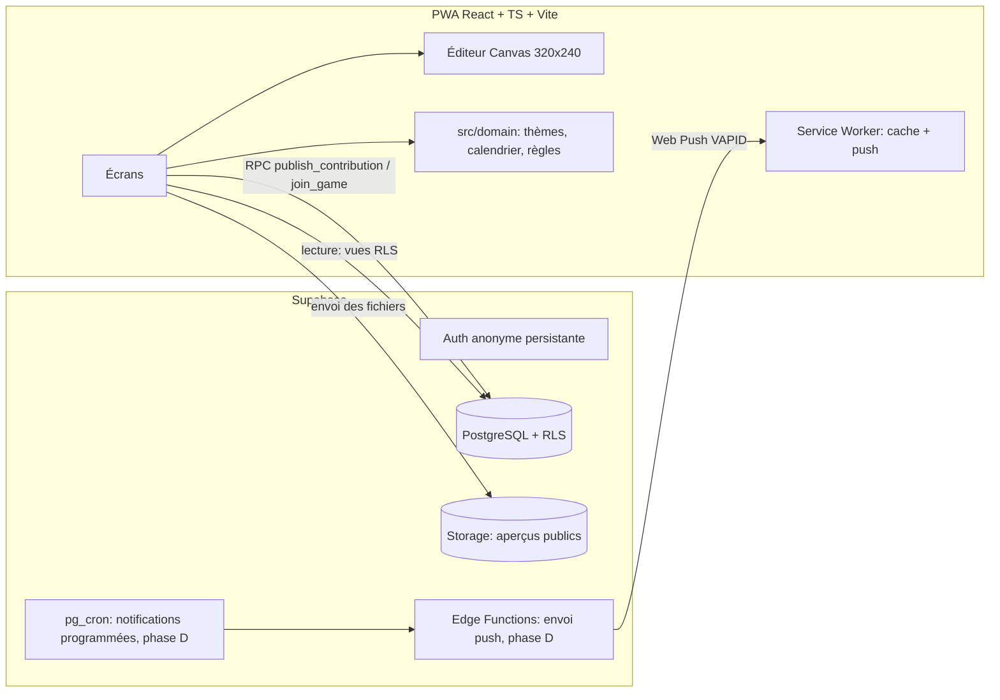
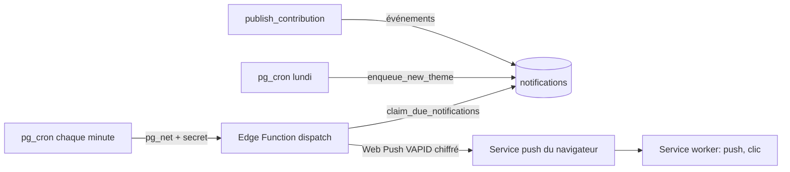

# Architecture

## Vue d'ensemble

Le dossier `src/domain` est du TypeScript pur, sans I/O : il est exécuté dans le navigateur (aperçu, tests) et réutilisé par les Edge Functions (Deno) pour que le serveur applique exactement les mêmes règles.

## Décisions

- **Serveur autoritaire, sans Edge Function pour la publication.** Les fonctions `join_game` et `publish_contribution` sont `security definer`, identifient l'appelant par `auth.uid()` (jamais par un paramètre) et sont accessibles aux comptes anonymes (rôle `authenticated`). Le client n'envoie ni rang de case ni date : la fonction déduit le rang du parent, vérifie les règles et insère atomiquement. L'interdiction de continuer sa propre case est vérifiée dans la fonction **et** par un trigger `BEFORE INSERT` : elle reste garantie même sans passer par la fonction et sous publications concurrentes (l'auteur d'un parent est immuable, aucune course possible). Les écritures directes dans `contributions` sont refusées par la RLS.
- **Projet et fichiers.** Le client crée un `drawing_projects` en brouillon, envoie l'aperçu PNG (bucket public `previews`, 256 Kio, PNG seulement) sous `<uid>/`, enregistre le `drawing_assets`, puis appelle la fonction. La fonction refuse un projet qui n'est pas celui de l'appelant, déjà publié ou sans aperçu. Un projet publié est figé par la RLS. Limite connue : le serveur contrôle le type MIME et la taille, pas le contenu réel du PNG.
- **Thèmes pré-générés.** Le générateur TypeScript produit `0003_themes.sql` (2026–2030) : la partie de chaque semaine existe déjà, `current_game()` choisit la bonne selon l'heure du serveur. Un test vérifie que le fichier correspond exactement au générateur. Aucune fonction serveur ni tâche planifiée n'est nécessaire au changement de semaine; `ensure_weekly_game` (service_role) reste en secours. Penser à regénérer les thèmes avant fin 2030.
- **Calendrier.** Jeu continu 7j/7, aucune phase. Seul le thème change, le lundi 00:00 Europe/Paris. Côté serveur : `date_trunc('week', now() at time zone 'Europe/Paris')`. Côté domaine (dates civiles via `Intl`, changements d'heure testés) : utilisé pour la génération des thèmes. Le compte à rebours affiché est celui du prochain thème, corrigé de l'écart d'horloge du serveur, pas une échéance.
- **Thèmes.** xmur3 + mulberry32 (`src/domain/prng.ts`), graine `case-ludique/<année ISO>-W<semaine>`, version `v1` figée. Tables avec étiquettes de compatibilité et accords de genre. Le thème est stocké (`themes`, immuable par trigger) : aucune modification rétroactive. Toutes les salles d'une semaine partagent le thème ; un seed manuel crée une partie privée/test.
- **Salles.** 99 participants maximum ; une nouvelle salle s'ouvre automatiquement quand elle est pleine (`join_game`). Aucun emprunt de dessins entre salles : une salle vide propose directement une case 1. Continuer une case d'une salle dont on n'est pas membre inscrit le joueur si la salle a de la place, sinon `ROOM_FULL` (verrou de ligne sur la salle).
- **Contribution.** Une case 1 n'est possible que dans le thème actif (ou une partie privée) ; une continuation hérite de la salle et de la partie de son parent, donc d'une ancienne semaine elle garde son thème. Rang = rang du parent + 1, la case 4 n'a pas de suite. Branches illimitées, aucune limite quotidienne, seulement un débit maximal anti-abus (60/heure par défaut, verrou consultatif par joueur).
- **Arbre.** Table `contributions` avec `parent_id` (adjacence). Profondeur maximale 4 : une CTE récursive (`contribution_descendants`) sur l'index `contributions_parent` suffit. Les cases partagées ne sont jamais dupliquées ; une histoire est le chemin racine → feuille.
- **Concurrence.** Deux suites simultanées d'une même case = deux lignes distinctes, le parent n'est jamais modifié (`for share` empêche seulement un masquage concurrent).
- **Classement.** Aucun tri par popularité : les cases sans suite sont proposées en premier, les cases de l'utilisateur sont exclues.
- **Notifications.** Quatre événements : `new_theme`, `continuation`, `new_branch`, `story_completed` (`src/domain/notifications.ts`). Un destinataire reçoit au plus un événement par publication (terminée > continuation > nouvelle branche). Aucun rappel quotidien.
- **Identité.** Auth anonyme Supabase (persistante), rattachable ensuite à un e-mail.
- **Service worker.** `injectManifest` (fichier `src/sw.ts` écrit à la main) pour accueillir les gestionnaires `push` et `notificationclick` en phase D.
- **Coût.** Supabase offre gratuite + Edge Functions ; fichiers de dessin de moins de 1 Mio.

## Éditeur (phase B)

Un dessin = une image 320×240, six couleurs. La palette reprend la table « Frame Palette » du format KWZ de Flipnote Studio 3D (wiki `flipnote-studio-3d-docs`, CC-BY-SA 4.0) : blanc `#ffffff`, noir `#141414`, rouge `#ff1717`, jaune `#ffe600`, vert `#008232`, bleu `#06aeff`. Pas de calques, d'animation, d'import ni d'export de fichier : le PNG ne sert qu'à stocker l'aperçu dans Supabase.

Décisions de conception :

- **Modèle** (`project.ts`) : projet immuable par convention (historique par instantanés). Un tableau de 76 800 octets, un indice de palette par pixel (0 = blanc, aussi la gomme).
- **Session d'édition** (`session.ts`) : classe sans dépendance à React, entièrement testée; un trait = une entrée d'historique; la sélection déplacée est « flottante » et n'entre dans l'historique qu'à la validation; l'annulation pendant le flottement la restaure.
- **Tracé** (`raster.ts`) : Bresenham + touches, motifs ancrés en coordonnées absolues, remplissage par balayage de lignes (pas de récursion), pression Pointer Events.
- **Pointeurs** (`ui/Stage.tsx`) : `touch-action: none`, `getCoalescedEvents`, capture du pointeur, un second doigt annule le trait et passe en zoom/déplacement, la paume est rejetée tant que le stylet est posé. Page en `position: fixed` pendant l'édition pour éviter le défilement et l'élasticité iOS.
- **Pas de brouillons** : le dessin vit en mémoire dans `EditorScreen`; on le publie ou on le perd (confirmation en quittant s'il y a des traits). La route `#/draw/<id de la case parente>` continue une case, `#/draw` crée une case 1.
- **Stockage** : le serveur ne conserve que le PNG d'aperçu (`0005_png_only.sql` retire le projet JSON).

## Difficultés identifiées

- **Pression et Apple Pencil.** Pointer Events + `getCoalescedEvents`, `touch-action: none` sur le canvas, test réel iPad nécessaire.
- **iOS.** Web Push uniquement pour une PWA installée (iOS 16.4+) ; permission demandée sur geste utilisateur ; stockage purgeable par Safari.
- **Salle pleine pour un ancien thème.** Un nouveau joueur ne peut pas continuer dans une salle complète d'une ancienne semaine (`ROOM_FULL`) ; il peut continuer les histoires des autres salles où il a de la place.
- **Regroupement des notifications.** Index unique partiel sur `notifications (user_id, group_key) where sent_at is null`.

## Notifications Web Push (phase D)

- **Regroupement et délai** : `enqueue_notification` insère avec `on conflict (user_id, group_key) where sent_at is null do update set count = count + 1`; chaque événement attend 2 minutes pour que d'autres s'y joignent. Un joueur sans abonnement correspondant ne génère aucune ligne.
- **Un destinataire, un message** par publication : histoire terminée > continuation > nouvelle branche.
- **Réservation at-most-once** : `claim_due_notifications` (`for update skip locked`) marque les lignes comme envoyées avant l'envoi. Panne temporaire (réseau, 429, 5xx) : `release_notification` (3 tentatives). Abonnement expiré (404/410) : supprimé. Aucun appareil joignable → pas de relance inutile.
- **Préférences et silence** appliqués par appareil dans la réservation; une notification reçue pendant le silence attend. Heure de Paris.
- **Nouveau thème** : `enqueue_new_theme` (cron toutes les heures le lundi 06:00–20:00 UTC) ne fait rien avant 08:00 heure de Paris ni deux fois pour la même partie (`announced_games`).
- **Sécurité** : la fonction `dispatch` exige un secret partagé comparé en temps constant; les fonctions serveur sont réservées au `service_role`; le texte final est construit côté serveur avec des chemins internes seulement; le service worker revalide l'URL avant d'ouvrir.
- **iOS** : pas de simulation; l'interface explique qu'il faut installer l'application. Le service worker n'est pas actif en développement.
- **Limites connues** : la fonction n'a pas été exécutée sous Deno; un navigateur qui renouvelle son abonnement est réaligné au prochain démarrage de l'application (pas par le service worker, qui n'a pas de session).

## Ordre d'implémentation

A → B éditeur → C publication/lecture/archives → D Web Push → E finitions : toutes implémentées; voir le tableau d'avancement du README pour ce qui est vérifié en conditions réelles.
